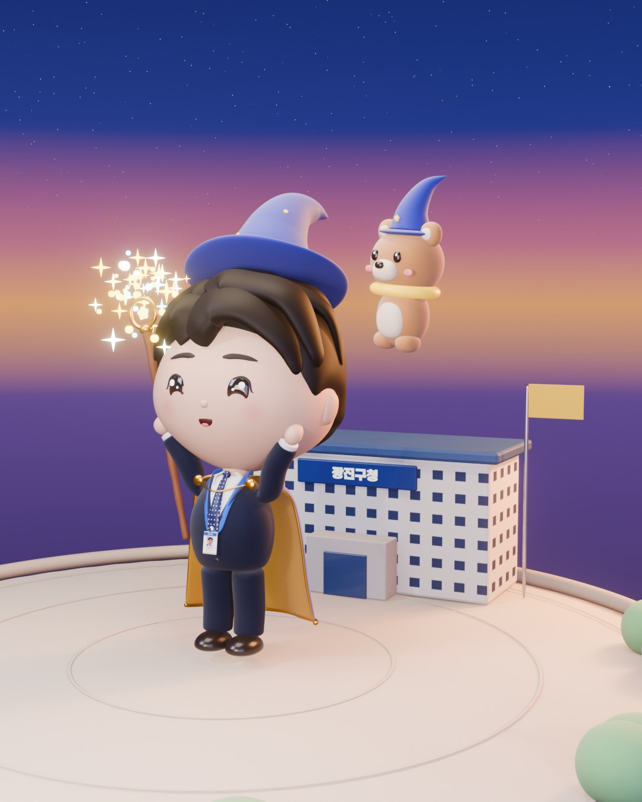

# FDE Wizard — 사진 한 장에서 3D 애니메이션까지



증명사진 한 장을 보고 Claude Code가 블렌더 파이썬으로 만든 치비 마법사 캐릭터입니다.
모델링 → 리깅 → 포즈 → 애니메이션 → 영상 합성(자막·음악·내레이션)까지 전부 스크립트이고, 블렌더는 화면 없이(`blender -b`) 돌립니다.

- 부품 69개 · 뼈 44개(팔다리 IK) · 포즈 8개 · 장면 16개
- 블렌더 파이썬 약 3,800줄 — `scripts/params.py` 의 숫자만 바꾸면 다른 캐릭터가 됩니다
- 만든 사람: 광진구청 류승인 주무관(공공AX FDE, Threads [@chris_gomdori](https://www.threads.com/@chris_gomdori))
- 영감: [@aztechnology_youtube](https://www.threads.com/@aztechnology_youtube) 님의 Claude Code × Blender 작업

## 준비물

| 필요한 것 | 용도 |
|---|---|
| [Claude Code](https://claude.com/claude-code) | 스크립트를 쓰고 고치는 쪽. 이 킷만 돌릴 거면 없어도 됩니다 |
| [Blender 5.2](https://www.blender.org/download/) | 설치만. 켤 필요 없어요 |
| Python 3 + `pillow numpy scipy` | 공무원증 텍스처·비교 시트·음악 |
| ffmpeg | 영상 합치기 |
| Node + Playwright | 자막·라벨 합성(HTML 캡처). `npm i -g playwright && npx playwright install chromium` |
| (선택) ElevenLabs API 키 | 내레이션. 환경변수 `ELEVENLABS_API_KEY` |

macOS(Apple Silicon)에서 만들고 돌렸습니다. 폰트는 없어도 돌아가고, 같은 모양을 원하면 `comp/FONTS.md` 를 보고 받아 넣으세요.

## 빠르게 돌려 보기

빌드 없이 보기만 하려면 `assets/fde_wizard_scene.blend` 를 블렌더 5.2로 열고, 에셋 브라우저에서 포즈를 누르세요.

```bash
python3 -m venv .venv && .venv/bin/pip install pillow numpy scipy
.venv/bin/python scripts/make_card.py                     # 공무원증 텍스처 (ref/photo.jpg 없으면 자리표시)
blender -b -P scripts/build_rig.py                        # 모델 + 리그 → build/rig.blend
blender -b build/rig.blend -P scripts/make_scene.py       # 포즈 8개가 든 장면 → out/fde_wizard_scene.blend
blender -b build/rig.blend -P scripts/shot.py -- a10_cast --preview --step 3   # 주문 장면 미리보기 → renders_preview/
```

`out/fde_wizard_scene.blend` 를 블렌더에서 열고 에셋 브라우저에서 포즈(기본·대기·손인사·인사·주문·엄지척·짠·생각)를 누르면 자세가 바뀝니다.

### 영상까지

```bash
scripts/render_parallel.sh 4                               # 1080p 전 샷을 4갈래로 동시에 렌더 (M4에서 약 1시간, 두 번째 인자 32면 절반)
.venv/bin/python audio/narr.py A ; .venv/bin/python audio/narr.py B   # 내레이션 + 자막 큐(comp/narr_A.js·narr_B.js) — ElevenLabs 키 필요, 없으면 건너뛰기
.venv/bin/python audio/score.py A ; .venv/bin/python audio/score.py B   # 음악·효과음(내레이션 덕킹)
scripts/assemble.sh A ; scripts/assemble.sh B              # 라벨·자막 합성 + 소리 → out/A.mp4, out/B.mp4 (+ 올리기용 *_web.mp4)
```

### 웹에서 돌려 보기

```bash
blender -b build/rig.blend -P scripts/export_web.py      # 웹용 GLB(동작 6개 + 포즈 8개, IK·스프링은 키로 구움) → out/web/fde_wizard.glb
```

three.js `GLTFLoader` 로 불러 `AnimationMixer` 로 동작 이름(`idle`·`wave`·`bow`·`cast`·`tada`·`walk`, 포즈는 `pose_` 접두)을 틀면 됩니다. 볼터치·셔츠 V·넥타이 점 같은 무늬는 블렌더 셰이더라 글TF 로 안 넘어가니 웹에서 다시 그려야 해요(값은 같이 나오는 `out/web/shader.json`). 완성본은 [chris.gomdori.app/wizard](https://chris.gomdori.app/wizard) 에서 직접 돌려 볼 수 있습니다.

음악은 macOS Logic/GarageBand의 스타인웨이 샘플·잔향이 있으면 그걸 쓰고, 없으면 합성 피아노·합성 잔향으로 대신합니다. 내레이션 단계를 건너뛰면 음악만 깔립니다(자막은 저장소에 들어 있는 `comp/narr_A.js`·`narr_B.js` 대로 나와요).

## 내 캐릭터로 바꾸기

1. `ref/photo.jpg` 에 본인 사진, `scripts/params.py` 의 `PROFILE` 에 소속·이름
2. Claude Code에 `docs/PROMPTS.md` 의 「내 캐릭터로 바꾸기」 프롬프트를 붙여 넣기
3. 캐릭터 손잡이는 전부 `scripts/params.py` 에 있어요. 영상 속 문구(자막·내레이션·엔드카드·이름)는 `comp/engine.js`, `comp/comp.html`, `audio/narr.py` 에서 바꿉니다

| 손잡이 | 바뀌는 것 |
|---|---|
| `HEAD`, `FACE` | 머리 크기·볼, 눈 위치·크기·눈웃음(`eye_smile`)·눈썹·입 |
| `HAIR`, `HAIR_LOCKS` | 머리카락 두께, 다발마다 (방위°, 고도°, 띄움) 경로 — 가르마·웨이브 |
| `BODY`, `CAPE`, `HAT`, `STAFF`, `BADGE` | 몸·망토·모자·지팡이·공무원증 |
| `COLORS` | 피부·머리·정장·넥타이 도트·망토 안감 등 모든 색 |

## 구성

| 파일 | 하는 일 |
|---|---|
| `scripts/params.py` | 한 사람분 데이터(치수·색·뼈 길이·프로필) |
| `scripts/build_model.py` + `parts_*.py` | 머리·얼굴·머리카락 / 정장·넥타이·팔다리 / 망토·모자·지팡이·공무원증 / 곰돌이 |
| `scripts/build_rig.py` | 뼈 44개, 팔다리 IK(극 각도 자동 보정), 가중치 직접 계산, 리그 시각화, 빠진 부품 검사 |
| `scripts/poses.py`, `anim.py` | 포즈 사전, 포즈 사이 키잉, 모자·망토·공무원증 스프링 굽기 |
| `scripts/shots_making.py`, `shots_ax.py`, `shot.py` | 제작영상 11샷, 공공AX 영상 6막, 샷 렌더러 |
| `scripts/fx.py`, `set_props.py`, `set_ax.py`, `stage.py` | 반짝이·한글 룬 마법진·펑 연기 / 소품 / 노을 하늘·떠 있는 섬·구청 / 조명·카메라·블룸 |
| `comp/` | 합성(HTML + Playwright): 단계 라벨, 코드 칩, 포즈 선반, 자막, 카운터, 엔드카드 |
| `audio/` | 120BPM 작곡 + 효과음 큐 + 내레이션 생성·자리 맞춤 |
| `scripts/export_web.py` | 웹용 GLB 내보내기(서브디비전 1단, 동작·포즈 액션, 곰돌이는 따로 움직이는 노드) |
| `scripts/qa_tiles.py`, `teaser.py`, `hero.py`, `thumbs.py` | 전 프레임 검수 타일, 예고 이미지, 대표 이미지, 엔드카드 썸네일 |
| `docs/PROMPTS.md` | 따라 하기 프롬프트와 실제로 쓴 요청들 |
| `docs/PITFALLS.md` | 삽질 기록 |

## 라이선스

코드는 MIT. 폰트·음원 샘플은 들어 있지 않습니다. 기본값 캐릭터는 만든 사람의 얼굴을 본떴으니, 쓰실 땐 본인 캐릭터로 바꿔 주세요.
